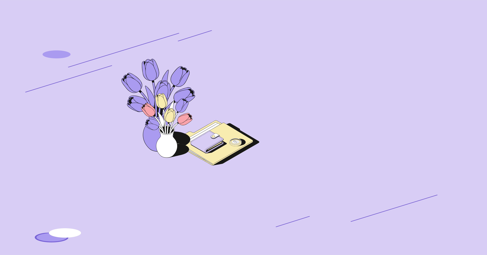
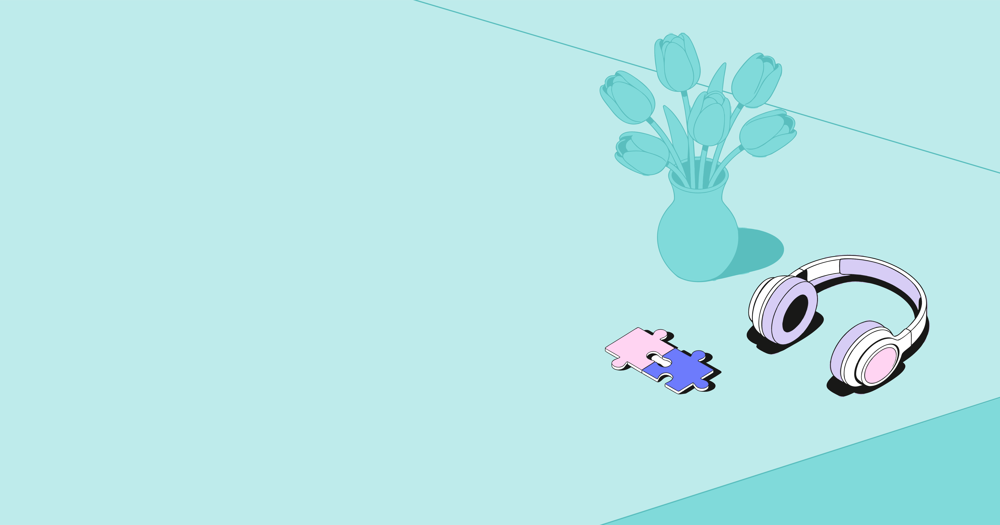
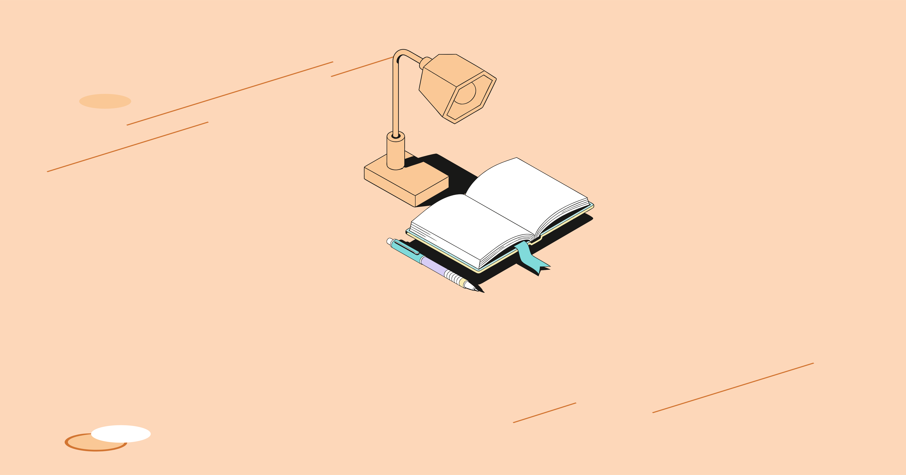

#  SVG Composition Builder

Интерактивный веб-сервис для создания изометрических SVG-композиций из готовых векторных объектов. Позволяет собирать иллюстрации двумя способами: через генерацию по текстовой метафоре с помощью ИИ или путём ручной сборки из библиотеки компонентов.

> **Ключевое ограничение:** сервис не генерирует новые объекты — итоговая иллюстрация состоит только из элементов исходной библиотеки (20 SVG-компонентов). AI-инструменты используются только для подбора и расстановки объектов по метафоре.

   > **Живая демо-версия:** [https://svg-composition-builder.vercel.app](https://svg-composition-builder.vercel.app)
---

##  Возможности

### Сценарий 1: ИИ-сборка по метафоре
Пользователь вводит метафору или заголовок (например, *«Обучение»*, *«Цветочный магазин»*, *«Творчество»*), выбирает тип композиции и размер — программа автоматически компонует подходящие объекты в сцену.

### Сценарий 2: Ручная сборка
Пользователь выбирает нужные компоненты из библиотеки (включая фоновые shade-объекты) и самостоятельно собирает композицию на холсте.

### Общие возможности
- **Поиск по названию и ключевым словам** с автодополнением (Сценарий 2)
- **Drag & Drop** — перемещение объектов мышью
- **Управление слоями** — перемещение вперёд/назад
- **Трансформации** — поворот на 90°, масштабирование, дублирование
- **Выбор типа композиции:** Собранно / Со смещением / Под заголовок
- **Выбор размера:** L (крупно) / S (мелко) с автоматическим масштабированием
- **3 цветовые палитры** с автоматической перекраской SVG в реальном времени
- **2 типа фона** (Ровная поверхность / Край стола), независимых от палитры
- **Экспорт в SVG** — векторный файл, редактируемый в любом графическом редакторе

---

##  Архитектура проекта

### Стек
- **Frontend:** React 18 + Vite
- **Стилизация:** Tailwind CSS
- **Состояние:** встроенные хуки React (`useState`, `useEffect`, `useRef`)
- **AI API:** OpenRouter (единая точка доступа к LLM)

### Как устроено хранение и использование SVG
1. **Библиотека компонентов** описана в `src/data/components.json` — для каждого объекта хранятся: путь к SVG-файлу, тип (`main` / `shade`), ключевые слова для поиска.
2. **SVG загружаются асинхронно** как текстовые строки при старте приложения и кэшируются в состоянии `svgContents`.
3. **Перекраска** выполняется на клиенте через замену атрибутов `fill` по словарю соответствия цветов (сохраняет светлоту исходных объектов — светлые поверхности остаются светлыми, тени тёмными).
4. **Фоны** (`bg_header.svg`, `bg_full.svg`) хранятся в `public/svg/` и перекрашиваются по отдельному словарю hex→роль.
5. **Экспорт** формируется путём инъекции `<g transform="...">` для каждого объекта в единый `<svg>` документ 1200×630 и скачивания через `Blob` + `URL.createObjectURL`.

### Валидация ИИ-вывода
На стороне клиента применяется функция `remapItems`, которая нормализует координаты, полученные от ИИ, в целевые зоны выбранного типа композиции. Это гарантирует, что даже при неточном ответе модели объекты не «развалятся» по холсту, а сохранят композиционную логику (центр / диагональ / правая половина).

---

##  AI-инструменты

### Используемая модель
**`nvidia/nemotron-3-nano-omni-30b-a3b-reasoning:free`** — бесплатная мультимодальная модель через OpenRouter.

Это один из подобранных бесплатных вариантов, который неплохо справляется с задачей составления изометрических композиций. Модель хорошо следует сложным пространственным инструкциям (координаты, размеры, слои) и поддерживает few-shot примеры в промпте.

**Особенности использования:**
- Может отвечать медленнее платных аналогов (10–30 секунд на запрос)
- Для доступа к OpenRouter API из некоторых регионов требуется VPN
- Бесплатный тариф достаточен для демонстрационных целей
- При необходимости можно переключиться на платную `openai/gpt-4o-mini` или любую другую модель

### Промпт-инжиниринг
- **Few-shot примеры** — 3 эталонных композиции с точными координатами и пояснениями
- **Жёсткие числовые ограничения** для координат (`x`, `y`) в зависимости от типа композиции
- **Правила иерархии размеров** (scale): крупные shade 2.0–2.5, средние main 1.2–1.8, мелкие детали 0.9–1.3
- **Физические ограничения** (что на чём может лежать, запрет на два вертикальных объекта)
- **Смысловые пары** (обучение = книга+лампа+ручка, финансы = кошелёк+монета+папка)

---

##  Как запустить

### Требования
- Node.js v18+
- API-ключ OpenRouter (получить на [openrouter.ai](https://openrouter.ai))

### Установка и запуск

```bash
# Клонировать репозиторий
git clone <url-репозитория>
cd svg-composition-builder

# Установить зависимости
npm install

# Создать файл .env в корне проекта
echo "VITE_OPENAI_API_KEY=ваш_ключ_здесь" > .env

# Запустить сервер разработки
npm run dev
Откройте http://localhost:5173 в браузере.

# Сборка для продакшена
npm run build
npm run preview

```

##  Структура проекта

svg-composition-builder/
├── public/
│   └── svg/                    # SVG-ассеты
│       ├── bg_full.svg         # Фоновый узор "Треугольник"
│       ├── bg_header.svg       # Фоновый узор "Точки и линии"
│       ├── book.svg
│       ├── book_shade.svg
│       └── ... (остальные компоненты)
├── src/
│   ├── components/
│   │   └── Background.jsx      # Компонент рендеринга фона
│   ├── data/
│   │   ├── components.json     # Метаданные SVG-компонентов
│   │   ├── palettes.json       # Конфигурация цветовых палитр
│   │   └── compositionPatterns.json  # Готовые паттерны композиций
│   ├── utils/
│   │   └── background.js       # Утилиты перекраски и генерации фона
│   ├── App.jsx                 # Основная логика приложения
│   └── main.jsx
├── examples/                   # Примеры готовых композиций
│   ├── example_1_learning.svg
│   ├── example_2_finance.svg
│   └── example_3_creative.svg
├── .env                        # API-ключ (не коммитить!)
├── package.json
└── README.md

## Примеры собранных композиций

### Творчество (тип «Собранно», размер L, палитра «Фиолетовая», фон «Ровная поверхность»)



Ваза с цветами (shade + main) + папка + кошелёк + монета. Плотная группа в центре холста. Ваза-силуэт на заднем плане создаёт глубину, основные объекты на переднем плане образуют сцену «творческая студия / магазин».

---

### Музыка (тип «Со смещением», размер L, палитра «Мятная», узор «Край стола»)



Ваза с цветами (shade) + наушники + пазлы. Диагональная раскладка: ваза справа-вверху как фоновый элемент, наушники и пазлы на переднем плане справа-внизу. Левая половина холста свободна — под заголовок.

---

### Обучение (тип «Собранно», размер L, палитра «Персиковая», узор «Ровная поверхность»)



Лампа (shade) + книга + ручка. Классическая смысловая пара «обучение»: лампа-силуэт на заднем плане, книга и ручка на переднем. Все объекты сгруппированы в центре, лампа визуально «светит» на книгу.

---

### Как были получены примеры

Все три композиции собраны через ИИ-сборку по метафоре с последующей ручной доработкой: удалены лишние объекты, скорректированы слои и масштаб. Это демонстрирует основной workflow сервиса — ИИ создаёт смысловую заготовку, пользователь доводит её до финального вида. На примерах также показана работа системы палитр и фоновых узоров: одна и та же композиция выглядит по-разному в зависимости от выбранной цветовой схемы.

##  Лицензия и происхождение материалов

Проект разработан по техническому заданию. Векторные иллюстрации и цветовые палитры предоставлены заказчиком и не будут использоваться в коммерческих целях.

AI-инструменты (OpenRouter API, модели Nemotron/Llama/Qwen) использованы в рамках демонстрации возможностей интеграции LLM в веб-приложения.

## Автор

Милана Солодовник